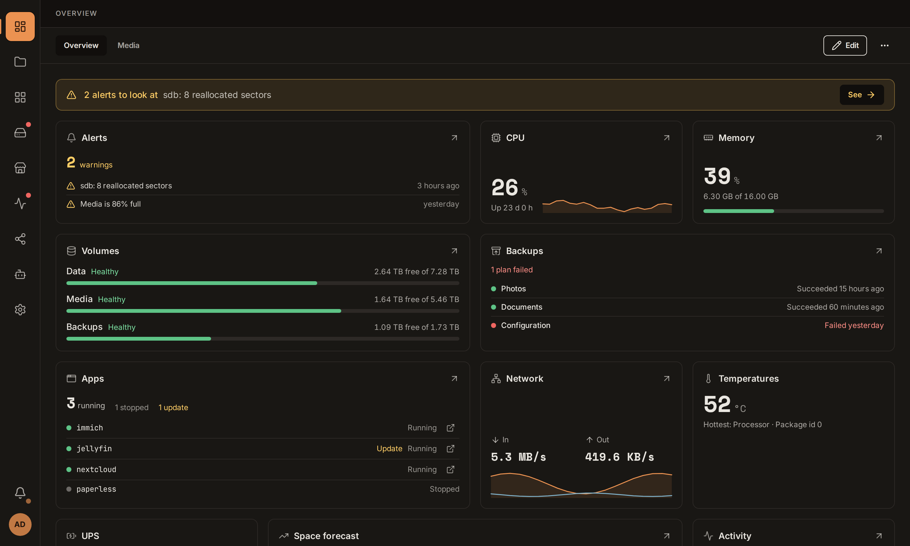
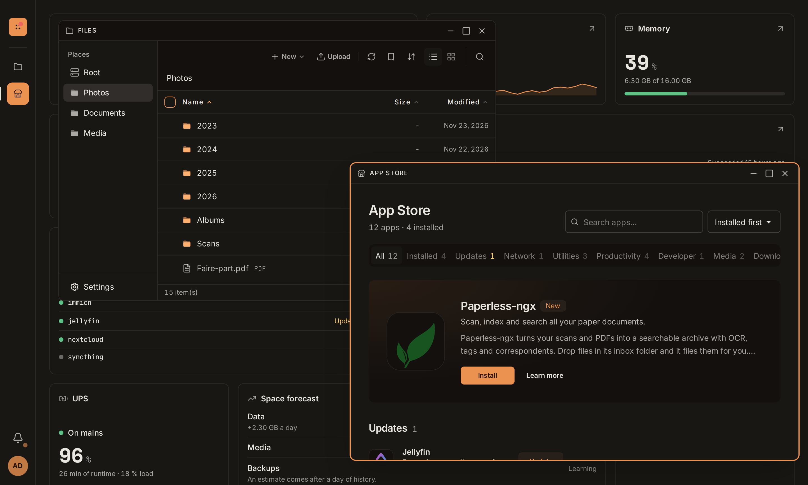
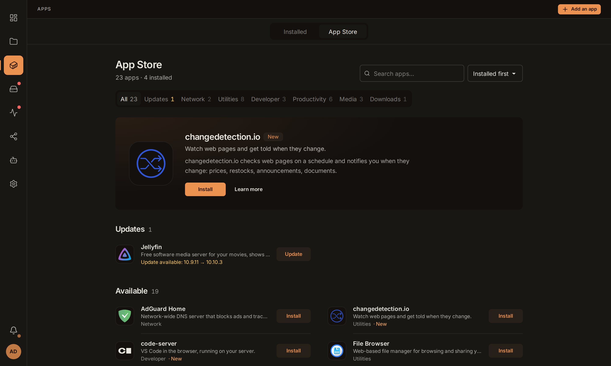
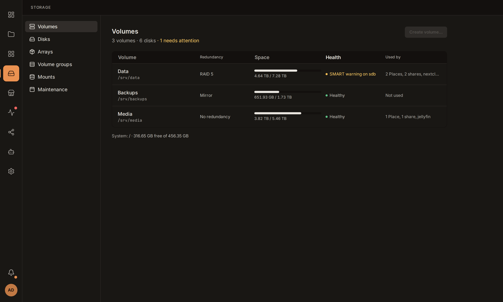
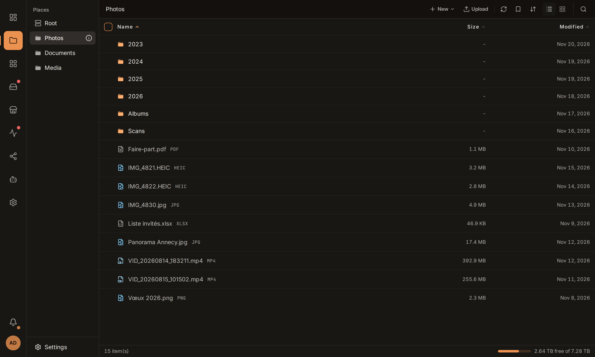
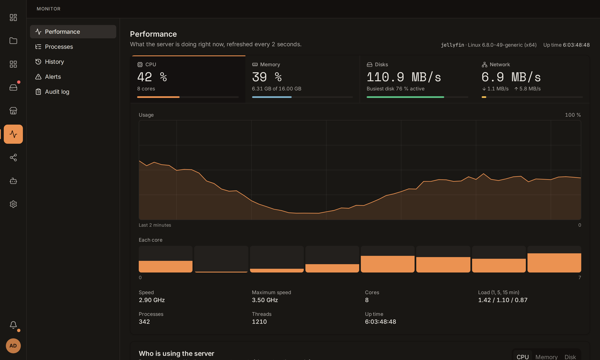

<h1 align="center">Home Server Interface</h1>

<p align="center">
  <strong>Your Linux home server, managed from one dashboard.</strong>
</p>


<p align="center">
  <a href="https://github.com/kittyruntime/home-server-interface/releases/latest"></a>
  <a href="LICENSE"></a>
  <a href="https://kittyruntime.github.io/home-server-interface/"></a>
  <a href="#requirements"></a>
</p>

<p align="center">
  <a href="#quick-install">Install</a> ·
  <a href="#features">Features</a> ·
  <a href="#screenshots">Screenshots</a> ·
  <a href="https://kittyruntime.github.io/home-server-interface/">Documentation</a> ·
  <a href="https://github.com/kittyruntime/home-server-interface/releases">Releases</a>
</p>

<p align="center">
  
</p>

Home Server Interface (HSI) brings file management, storage, Docker apps, backups,
and server monitoring into a web interface for your own hardware. It runs on a
single Linux host and works with standard tools including Docker Compose,
Samba, mdadm, LVM, and systemd. You keep shell access and control of the machine.

## Features

| Area | What you can do |
| --- | --- |
| **Files** | Browse and edit files, upload with pause/resume support, create expiring share links, and control access through places and permissions. |
| **Apps and containers** | Install apps from the App Store; manage containers, logs, networks, and mounts; import Compose settings. App definitions remain accessible in `/opt/containers`. |
| **Storage** | Inspect S.M.A.R.T. health, manage partitions and mounts, and configure mdadm RAID and LVM. |
| **Monitoring** | Track CPU, memory, network, and storage metrics; review historical activity, disk alerts, and privileged-action audit logs. |
| **Users and sharing** | Manage users, groups, access permissions, and SMB shares through Samba. |
| **Backups** | Export encrypted HSI configuration backups and schedule rsync jobs locally or over SSH. |

Use the dashboard or the desktop-style windowed interface. See the
[feature documentation](https://kittyruntime.github.io/home-server-interface/guide/features/storage/)
for capabilities and configuration details.

## Quick install

### Requirements

- **Ubuntu 24.04, x86-64.** Other distributions are not officially supported.
- Root access or `sudo`, and `curl`.
- Network access to download the installer, release, and dependencies.
- Port **9001** reachable from the devices that will access HSI.
- Docker for containers and the App Store; Samba for SMB sharing.

The installer checks and installs required host packages, creates the application
user, and configures the backend, privileged worker, and NATS broker as systemd
services.

Run on the server:

```bash
curl -fsSL https://raw.githubusercontent.com/kittyruntime/home-server-interface/main/scripts/install.sh | sudo bash
```

You can [read the installer](scripts/install.sh) before running it. For installation
options and version pinning, see the [installation guide](https://kittyruntime.github.io/home-server-interface/guide/install/).

### First login

1. Open the **one-time setup link** printed by the installer.
2. Follow the [secure access guide](https://kittyruntime.github.io/home-server-interface/guide/secure-access/) to verify and trust the local certificate authority. HSI serves HTTPS on port `9001`; your browser initially shows a certificate warning.
3. Create your administrator account, then use the setup assistant to configure the server.

There is no default username or password. If you lose the setup link before
creating an administrator, generate another on the server:

```bash
sudo hsi-worker setup-token
```

## Screenshots

| Desktop mode | App Store |
| --- | --- |
|  |  |

| Storage | File manager |
| --- | --- |
|  |  |

<details>
<summary>Monitoring and animated demo</summary>



[Watch the animated demo](website/src/assets/demo.gif).

</details>

## Updates and maintenance

Update from the administrator dashboard, or rerun the installation command.
The installer preserves the existing database and secrets.

Release installations verify signatures and checksums, keep previous versions,
and snapshot configuration and database state before switching versions. A failed
health check triggers an automatic rollback. See the
[update and rollback guide](https://kittyruntime.github.io/home-server-interface/guide/install/#update)
for details and recovery commands.

Check the services on the host:

```bash
systemctl status hsi-server hsi-worker hsi-nats
```

Review [release notes](https://github.com/kittyruntime/home-server-interface/releases)
before updating, and keep backups of your configuration and data.

## Project status

HSI is published and actively developed. Features and interfaces may change
between releases. Ubuntu 24.04 on x86-64 is the tested platform.

HSI has not undergone a formal security audit. Keep it updated and avoid exposing
it directly to the internet. Storage operations affect real disks; maintain
backups of important data.

The web backend runs as an unprivileged user. A separate Go worker handles
privileged host operations through NATS. Read the
[architecture documentation](https://kittyruntime.github.io/home-server-interface/development/architecture/)
for the process model and privilege boundaries.

## Documentation

The [documentation site](https://kittyruntime.github.io/home-server-interface/)
covers installation, everyday administration, and development.

| Guide | Contents |
| --- | --- |
| [Installation](https://kittyruntime.github.io/home-server-interface/guide/install/) | Requirements, setup, updates, rollback, and services |
| [Secure access](https://kittyruntime.github.io/home-server-interface/guide/secure-access/) | HTTPS and trusting your server's certificate authority |
| [Configuration](https://kittyruntime.github.io/home-server-interface/reference/configuration/) | Environment variables, host packages, ports, and logs |
| [Manage without HSI](https://kittyruntime.github.io/home-server-interface/guide/manage-without-hsi/) | Work directly with the underlying Linux tools and configuration |
| [Development](https://kittyruntime.github.io/home-server-interface/development/setup/) | Local environment, builds, checks, and releases |

## Contributing

Bug reports, documentation improvements, translations, and code contributions
are welcome. Read the [Code of Conduct](CODE_OF_CONDUCT.md) before participating.

- **Report a bug:** [open an issue](https://github.com/kittyruntime/home-server-interface/issues) with your HSI version, operating system, reproduction steps, and relevant logs. Remove credentials and private information from logs.
- **Suggest a feature:** describe the problem you want to solve and how it fits your server workflow.
- **Submit a change:** follow the [development setup](https://kittyruntime.github.io/home-server-interface/development/setup/), keep the pull request focused, and explain how you verified it. Discuss substantial changes in an issue first.

### Work on the source

```bash
git clone https://github.com/kittyruntime/home-server-interface.git
cd home-server-interface
pnpm install
```

Development requires Node.js `^20.19.0 || >=22.12.0`, pnpm `>=10.18.0`, Go
`>=1.25`, and a local NATS service. Follow the development guide for the database,
environment, and four application processes. Use a disposable VM: the privileged
worker performs real operations on its host.

Run the repository checks after setting up the development environment:

```bash
pnpm verify
```

To install from a source checkout instead of a published release:

```bash
sudo bash scripts/install.sh --from-source
```

Source installations use a different layout and do not include the signed-release
update and health-gated rollback workflow. See the installation guide before
choosing this route.

## License

Home Server Interface is released under the [Mozilla Public License 2.0](LICENSE).

© 2025–2026 kittyruntime
