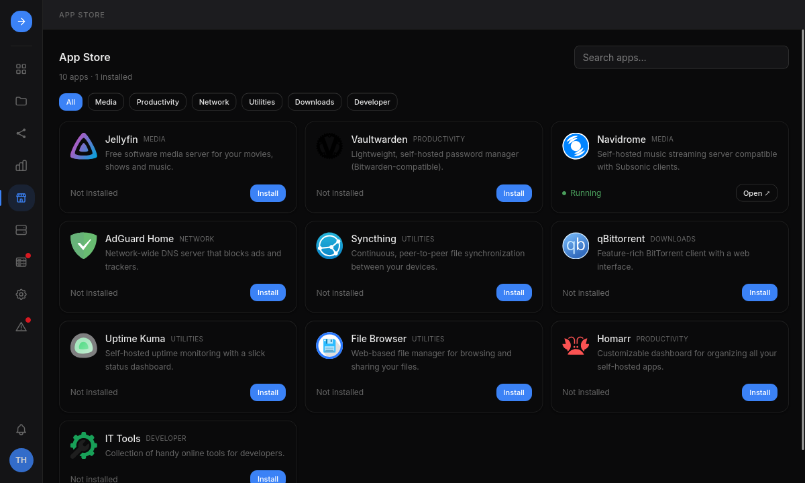

Run self-hosted apps and containers without a shell. Apps and containers are
admin-only.

- **App Store**: a curated catalog with guided installs and pinned image versions.
  Secret settings can be generated, and a port already in use comes with a free
  one to switch to. After an install, HSI opens the new app with its logs.
  Each app has a page with its description, version and what the install asks
  for; the Installed and Updates filters find the apps already on the server.
- **Finding apps**: search, filter by category, installed apps or updates, and
  sort installed first, by name or the latest added first. Apps that joined the
  catalog in the last 60 days are marked New; nothing is ranked by popularity.
- **App updates**: when a new HSI version ships a newer image for an installed
  App Store app, its card and page say so with a link to the release notes, and the
  Apps page marks it. **Update…** previews the one changed line of
  `compose.yaml`, keeps the current file as `compose.yaml.previous`, and
  recreates the app if it runs (a stopped app gets the new image when it
  starts). **Roll back…**, on the app's page, puts the previous image back (later edits to the file
  are kept) and starts the app. An image changed by hand
  to another repository or to a newer tag is left alone.
- **Containers**: create, edit, start, stop and delete containers, read their
  logs, and manage networks, volumes and mounts. An existing Compose file can be
  imported to prefill a container.
- **Previewed changes**: saving, applying, starting, installing and deleting show
  the `compose.yaml` content or its diff and the `docker compose` commands before
  they run. Secret-looking values are masked in the preview and the audit log.
- **Docker checks**: when Docker is not installed, not running or missing the
  compose plugin, the Apps page and the App Store say so with the command that
  fixes it.

Every app is a Docker Compose project in `/opt/containers/<name>/compose.yaml`,
usable with or without HSI. An app that stores data on a volume is stopped when
that volume goes missing.

## Without HSI

See [Docker](/home-server-interface/guide/manage-without-hsi/#docker).
