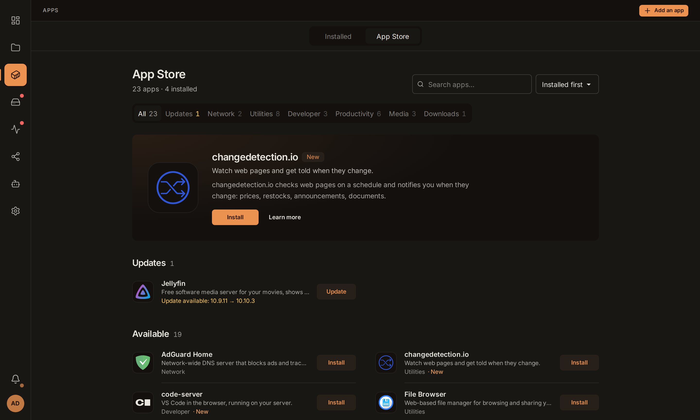
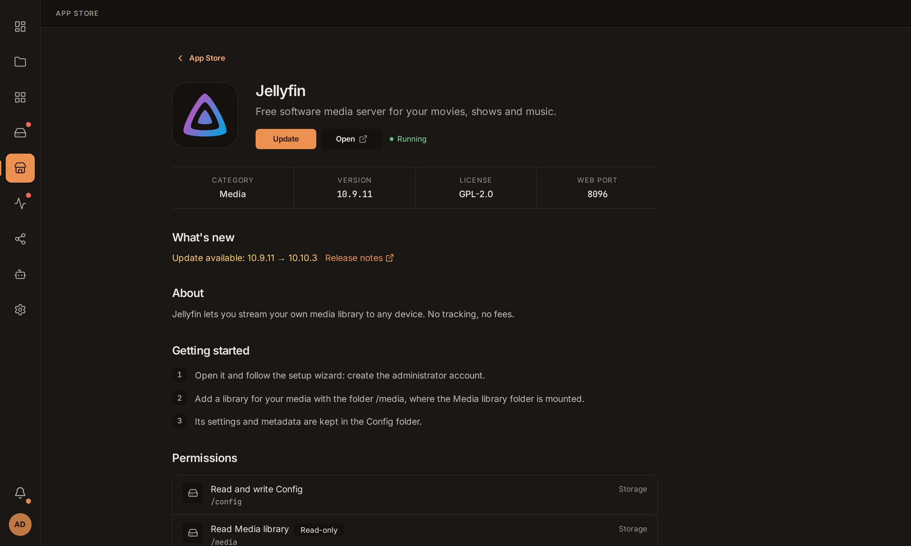
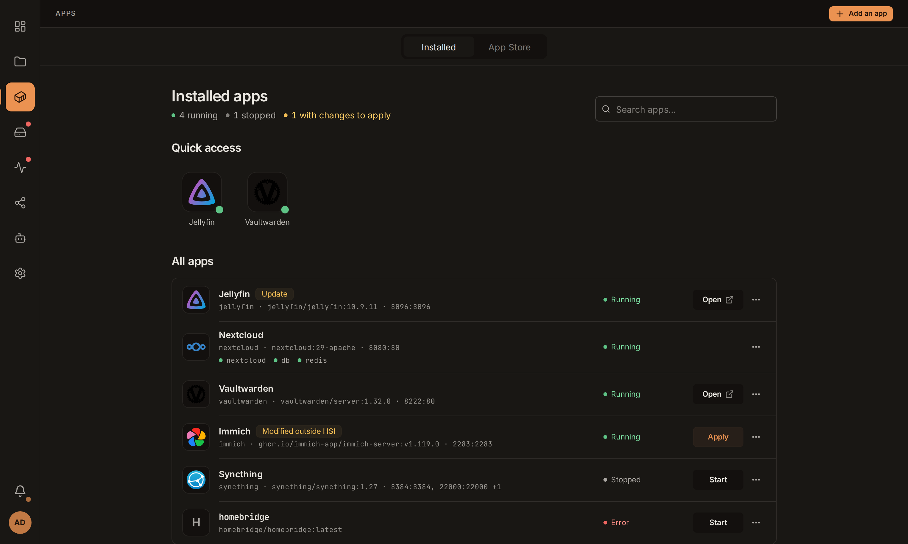

Run self-hosted apps and containers without a shell. Everything about apps
lives in one app, **Apps**, for administrators: **Installed** lists the apps
the server runs, **App Store** adds more. The switch at the top goes from one
to the other and each keeps its place.

Every app is a Docker Compose project in `/opt/containers/<name>/compose.yaml`,
usable with or without HSI. An app that stores data on a volume is stopped when
that volume goes missing.

## The App Store

A curated catalog with guided installs and pinned image versions.

- **Layout**: the top of the store suggests one app the server does not run
  yet, the newest first. Below, apps are grouped in **Updates** and
  **Available**, each row with the app's logo, tagline and one button:
  **Install** or **Update**. The installed apps are in the Installed view, and
  show here too, with **Open**, through a category or a search.
- **Finding apps**: search, pick a category, and sort installed first, by name
  or the latest added first. Apps that joined the catalog in the last 60 days
  are marked New; nothing is ranked by popularity.
- **An app's page** opens on its logo and its main action, then a strip of
  facts (category, version, license, web port), what's new when an update or a
  rollback is available, a description and the services it installs with, its
  first steps (first sign-in, where to put files), what the install asks for
  (storage, network ports, secrets, start at boot) and links to its website,
  documentation, source code and release notes. The first steps show again
  once the app is installed.
- **Installing**: secret settings can be generated, and a port already in use
  comes with a free one to switch to. The web port can be given the address of
  your own reverse proxy or tunnel (with HTTPS or not), which **Open** then
  uses; HSI does not set up the proxy. After an install, HSI opens the new app
  with its logs.
- **Catalog updates**: the catalog ships with each HSI release, and HSI also
  checks the signed online catalog when it starts and every 12 hours, so new
  apps can appear between releases. The bottom of the store says which catalog
  is in use and when it was last checked; **Check for new apps** checks now.
  An app that needs a newer HSI is left out and named there.

## App updates

When a new catalog or HSI version ships a newer image for an installed App
Store app, the store lists it under Updates with a link to the release notes,
and the Installed view marks it. **Update…** previews the one changed line of
`compose.yaml`, keeps the current file as `compose.yaml.previous`, and
recreates the app if it runs (a stopped app gets the new image when it starts).
**Roll back…**, on the app's page, puts the previous image back (later edits to
the file are kept) and starts the app. An image changed by hand to another
repository or to a newer tag is left alone.

## Installed apps

- **Summary**: a line under the title counts the apps running, stopped and
  waiting for changes to be applied. Search filters the list by name, image or port.
- **Quick access**: apps with a pinned address show as icons at the top, to
  open them in one click. **Pin to quick access**, in an app's menu, asks for
  the address to open.
- **The list**: each app shows its logo and name when it comes from the App
  Store (its initial otherwise), its container name, image and ports, the state
  of each service and the app's state. One button does what fits the state:
  **Open**, **Start**, **Apply** (when the saved file differs from what runs)
  or **Check status**. The **…** menu holds the rest: start, stop, restart,
  apply changes, logs, pin, edit and delete.
- **Adding an app by hand**: **Add an app**, in the header, asks what to add:
  - **One app**: a container from an image, set up in a form (ports, volumes
    and mounts, environment variables, labels, networks, limits);
  - **Several services**: a Compose file, pasted or chosen, kept as is as the
    app's `compose.yaml`, then added and started, or only added.
  It also links to the App Store for a ready-made app.
- **Editing**: edit an app to change its services, image, ports, volumes and
  mounts, environment variables, labels and networks.
- **Unmanaged containers**: containers that run on the server but were not
  created by HSI are listed under the apps, and **Import** adopts one as an app
  HSI manages.

## Safety

- **Deleting an app keeps its data**: its containers and `compose.yaml` go, its
  Docker volumes (databases, caches) stay, and installing it again under the
  same name uses them. Tick **Also delete its data in Docker volumes** to delete
  them too; the preview names them. Folders in Places are never deleted.
- **Previewed changes**: saving, applying, starting, installing and deleting show
  the `compose.yaml` content or its diff and the `docker compose` commands before
  they run. Secret-looking values are masked in the preview and the audit log.
- **Docker checks**: when Docker is not installed, not running or missing the
  compose plugin, Apps says so with the command that
  fixes it.
- **Background operations**: starting, stopping, installing and updating run in
  the background and show in the Activity panel with their logs.

## Without HSI

See [Docker](/home-server-interface/guide/manage-without-hsi/#docker).
