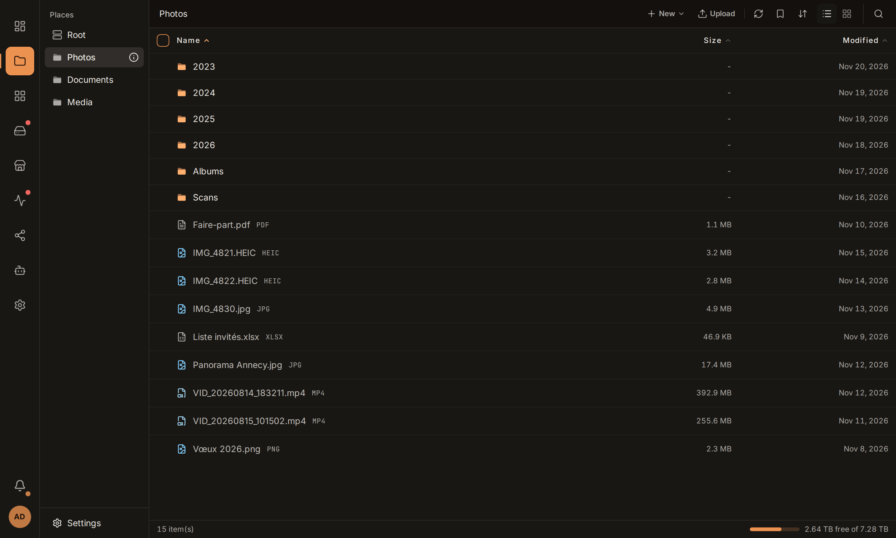
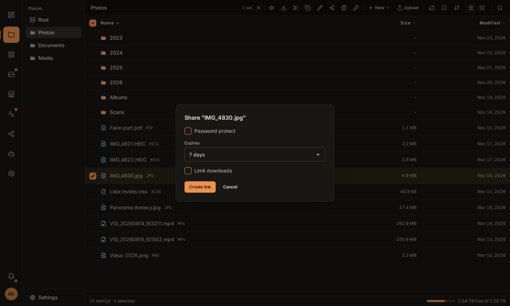

A full file manager in the browser.

## Browsing

The sidebar lists the Places you can open, your **bookmarks**, your **Shared
links** and the **Trash**. The path above the files can be copied with a click.

- **List or grid**: switch the view from the toolbar. **Sort and display**
  sorts by name (A-Z or Z-A), last or first modified, size or type, picks the
  columns of the list view (size, modified, type), the default view, and shows
  or hides hidden files (those whose name starts with a dot). These choices are
  kept on your account, so they follow you to another browser.
- **Filter and search**: **Filter by name** narrows the open folder; **Search**
  looks for a name in the folder and every folder under it.
- **Bookmarks**: add a folder from its menu, or drop it on the Bookmarks list.
  Bookmarks can be renamed and reordered. One that points to a folder that is
  gone, or that you can no longer open, says so.
- **Status line**: the number of items, the selection, and the free space on
  the disk the folder is on.

## Working with files

- **Select** with a click, Shift or Ctrl, or **Select all**. The toolbar and
  the right-click menu act on the selection: open, view, rename, download, copy,
  cut, paste, share, permissions, properties, compress, extract and delete.
- **Drag and drop**: drop files from your computer to upload them. Drop items
  on a folder to move them there; hold Ctrl or Alt to copy instead. A move can
  be undone from the message that confirms it.
- **Name conflicts**: when a copy or move meets a file or folder of the same
  name, choose **Keep both**, **Replace** or **Skip**, for one item or for all
  of them. Replacing a folder deletes the existing one and everything in it.
- **Archives**: **Compress to ZIP** packs the selection into one `.zip`;
  **Extract Here** unpacks a `.zip` into a folder named after it.
- **Long operations** (copies, moves, deletions, archives) run in the
  background and show in the Activity panel, where they can be cancelled.

### Keyboard

| Key | Action |
|---|---|
| Arrow keys, Home, End | Move the selection (with Shift to extend it) |
| Letters | Jump to the first item whose name starts with them |
| Enter | Open the selected item |
| Alt+Enter | Properties of the selected item |
| Backspace | Go to the parent folder |
| Delete | Delete the selection |
| F2 | Rename the selected item |
| Ctrl+A | Select everything in the folder |
| Ctrl+C, Ctrl+X, Ctrl+V | Copy, cut and paste |
| Ctrl+K | Filter the folder by name |
| Ctrl+H | Show or hide hidden files |

On a Mac, Cmd works in place of Ctrl for these shortcuts, except Ctrl+H.

## Uploads

Uploads are chunked and resumable: each chunk retries after a network blip,
uploads can be paused and resumed, and the server checks the whole file's
SHA-256 against the one the browser computed. Each upload shows in the
Activity panel with its percent, speed and time left. An upload interrupted by
closing the page asks for the file again to pick up where it stopped.

## Previews and the editor

- **Previews**: images, video, audio and PDF open in a preview. A PDF can also
  be opened in a new tab.
- **Editor**: text and code files open in a built-in editor, with a Format
  action (Shift-Alt-F) for JSON, YAML, CSS, HTML, Markdown, JavaScript and
  TypeScript. A binary file is not opened: download it instead.

## Properties and permissions

**Properties** shows an item's kind, size, location, dates, the volume it is
on, its permissions, owner and group. For a folder, **Calculate** counts its
files, folders and total size. For audio and video, **Read** gives the
duration, dimensions and codecs when `ffprobe` is installed on the server.
With **Advanced mode** on (in My profile), the raw UID and GID are shown too.

Administrators can change the Linux permissions of a file or folder (read,
write and execute for the owner, the group and others) and its owner and
group. For the folder of a Place, **Manage access…** opens the Place's
permissions instead.

## Deleting and the trash

An administrator can turn the **trash** on for a Place in Settings > Places,
and choose how many days an item stays in it before it is emptied. In a Place
with a trash, deleting moves the items to its trash and can be undone right
away. The Trash in the sidebar lists what you deleted, visible only to you
(administrators see everyone's): **Restore** puts an item back, under a new
name if something took its place, and **Delete permanently** or **Empty
trash** removes it for good. Turning the trash off asks whether to empty it
now or keep what it holds.

Where there is no trash, deleting is permanent and asks first. **Confirm before
deleting**, in My profile, turns that question off or back on.

## Share links

**Share** creates a public link to a file or folder. It can be protected by a
password, expire after 24 hours, 7 days or 30 days (or never), and stop after a
number of downloads. Anyone with the link can use it until then. **Shared
links**, in the sidebar, lists the links you created: revoke one to stop it at
once, or delete it. Sharing needs the Share permission on the Place.

## Places

A Place is a folder HSI exposes to its users, usually on a data volume. Access is
granted per user and per group, as Read, Write, Delete and Share. Administrators
have full access to every Place. A Place can be created when a volume is mounted,
so it shows up in Files right away, and shared over SMB (see
[Users and shares](/home-server-interface/guide/features/users-shares/)).
Each Place can have its own icon, picked from a set or any emoji.

Writing through the file manager acts as your Linux user, exactly as over SMB, so
permissions are the same either way. A "permission denied" error says which
account the operation ran as and who owns the target folder.
