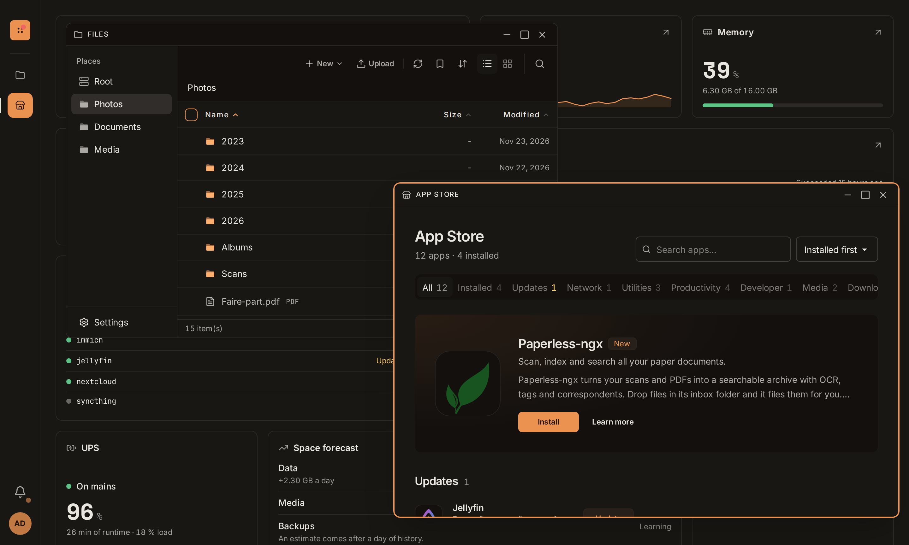

## Two ways to work

- **Sidebar** (the default): one app at a time, picked from the sidebar on the
  left. Drag the sidebar's items to put them in the order you like; **Reset
  sidebar order**, in the account menu, puts them back. On a phone the apps sit
  in a bar at the bottom of the screen.
- **Desktop mode**: turn it on from the account menu (your avatar). Apps open
  in windows you can move, resize, maximize (or double-click the title bar),
  minimize to the dock and close. The **Launchpad**, in the dock, lists every
  app. Your [boards](/home-server-interface/guide/features/dashboard/) stay
  behind the windows, and **Change wallpaper…** sets a color or an image of
  your own. Desktop mode is a choice of each device, so a phone can stay on
  the sidebar while a computer uses the desktop.

Storage, the App Store, Monitor and the Assistant are for administrators;
storage admins also get Storage, and accounts allowed to use the assistant get
the Assistant. Everything else is open to every account, with what each one
may do inside.

## Activity and notifications

The bell at the top opens the **Activity** panel:

- **In progress**: copies, moves, deletions, archives, uploads, app operations,
  backups and HSI updates while they run, with their progress. Uploads can be
  paused, resumed or cancelled; other tasks can be cancelled.
- **Notifications**: alerts, failed operations and updates, with what is new
  first. Mark them read, or clear them. **View logs** opens the log lines of an
  operation that failed.
- **History**: the background tasks that finished in the last 7 days, with how
  long they took.

Where else alerts go (email, Discord, Slack, ntfy, webhooks) is set by an
administrator in Settings > Notifications, see
[Monitoring and notifications](/home-server-interface/guide/features/monitoring/#notifications).

## My profile

Settings > My profile is for every account:

- **Display name** and **password** (the current one is asked for).
- **Language** of the interface, English or French, on every device you sign
  in to.
- **Appearance**: a **theme** (Paper, Graphite, Fog, Sage, Chalk, Ink, Moss,
  Plum or Onyx, or Auto to follow the light or dark setting of your device),
  an **accent color**, the **roundness** of controls (square to pill) and the
  **density** (compact, default or roomy). **Reset appearance** goes back to
  the defaults.
- **Confirm before deleting**: ask before deleting files for good in the file
  manager.
- **Advanced mode**: show extra technical detail where there is some, such as
  the raw UID and GID of files.

Your appearance, language, sidebar order, file manager display and delete
confirmation are kept on your account and follow you from one browser or
device to another. Desktop mode and advanced mode stay on the device.

## Settings

Settings groups everything an account can change. Most sections are for
administrators.

| Section | Who | What it does |
|---|---|---|
| My profile | Everyone | Name, password, language, appearance (above) |
| AI access | Everyone | Connect an AI assistant to your account, see [AI assistant](/home-server-interface/guide/ai-assistant/) |
| Users | User managers | Accounts, their roles (admin, user manager, storage admin) and their Linux and Samba identities, see [Users and shares](/home-server-interface/guide/features/users-shares/) |
| Places | Admins | Shared folders, their icon and their trash, see [Files](/home-server-interface/guide/features/files/#places) |
| Permissions, Groups | Admins | Who can read, write, delete and share in each Place |
| Alert thresholds | Admins | Disk usage percentages for warning and critical alerts |
| Notifications | Admins | Connectors and rules that send alerts out, see [Monitoring](/home-server-interface/guide/features/monitoring/#notifications) |
| Secure access | Admins | HTTPS, certificates and reverse proxies, see [Secure access](/home-server-interface/guide/secure-access/) |
| Network | Admins | The server's IPv4 address and DNS, see [Network](/home-server-interface/guide/network/) |
| Updates | Admins | Install HSI updates, restart HSI, reboot the server (below) |
| Telemetry | Admins | The anonymous daily heartbeat (below) |
| Backup & restore | Admins | Encrypted configuration backup, see [Backup and restore](/home-server-interface/guide/backup-restore/) |
| Data backups | Admins | Sync and versioned backup plans, see [Backups of your data](/home-server-interface/guide/data-backups/) |

### Updates, restart and reboot

**Updates** shows the current version and, when a newer release is out, its
notes and the pre-flight checks that must pass before it installs. The check
for new releases runs daily from a systemd timer. Installing restarts HSI
(about 30 seconds). See [Install](/home-server-interface/guide/install/#updates)
for how an update is kept safe and rolled back.

**Restart HSI** restarts the dashboard's backend without rebooting the
machine; **Reboot server** restarts the machine and everything on it. While an
update, a restart or a reboot runs, every open dashboard shows its progress,
pauses changes, and reloads once the server is back.

### Telemetry

Once a day, HSI sends an anonymous heartbeat: its version, release channel and
a hardware summary. No file names, users, addresses or settings. It helps
decide which systems to support. Settings > Telemetry shows exactly what is
sent and turns it off. `HSI_TELEMETRY_ENABLED=false` on the server turns it off whatever the switch
says, see [Configuration](/home-server-interface/reference/configuration/#environment-variables-backend). To have an
installation's data deleted, send its installation ID, shown there, with the
request.
