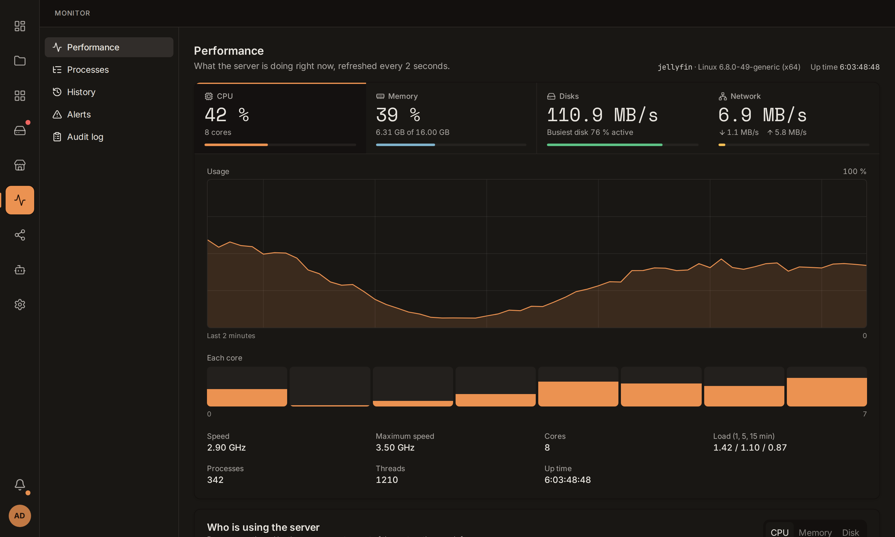

The Monitor app has five sections: Performance, Processes, History, Alerts and
Audit log.

- **Performance**: one panel with four readings, refreshed every 2 seconds:
  CPU, memory, disks and network, plus **Temperatures** on a machine that exposes
  sensors (the hottest one, and how close it is to its critical point). Pick one to see its detail under them: the
  last two minutes of CPU use with every core side by side, speed, load,
  processes and threads; memory composition and swap; every disk on its own
  line with its active time, read and write speeds and model; every network
  port with its receive and send rates, link speed and addresses; every
  temperature sensor (processor, NVMe, disks with the `drivetemp` module, board)
  with its last two minutes, its max and critical points, and the fan speeds.
  Below,
  **Who is using the server** ranks what runs on the machine by CPU, memory or
  disk activity: each app (its Docker containers), each account, HSI itself and
  the system. Picking one opens it in Processes.
- **Processes**: every program running on the server, gathered under the app,
  account or part of the system it works for and ranked the same way, with a
  search. Open an owner to see its processes, and select one to read its
  command line; **End process** then asks it to stop, and if it keeps running,
  the same button forces it. The system, its kernel threads and the processes
  that run HSI are protected and cannot be ended. Ending a process is recorded
  in the audit trail.
- **History**: CPU, memory and network over 1 hour to 7 days, with the average
  and the peak of each curve.
- **Alerts**: background checks raise alerts for a degraded array, a failing disk,
  a missing volume, a RAID consistency mismatch, a failed backup or update.
  Monitor > Alerts lists them; an alert whose condition is still true comes back
  at the next check.
- **Audit trail**: a filterable log of privileged actions, including every
  executed plan with the result of each step. Entries are kept for a year by
  default: set `retention_days` under `[audit]` in `/etc/hsi/hsi.toml` to
  change it, or to `0` to keep every entry. The change applies within a day.

## Notifications

Settings > Notifications routes alerts to connectors through rules. Each rule
filters by source and minimum severity. A default rule sends all alerts to the
bell menu.

- **In-app**: the bell menu, with an unread badge.
- **Webhooks**: editable JSON payload templates with presets for Discord, Slack,
  ntfy and [SmallTV](https://github.com/giovi321/smalltv-mod) desk screens, a live
  preview and a test send.
- **Email**: SMTP with STARTTLS, TLS or none, presets for Gmail and Fastmail.

Webhook and email messages go through a queue stored in the database: they
survive a restart, are retried, and are rate-limited per connector. Connector
secrets are encrypted. Details are in
[Notifications](/home-server-interface/reference/configuration/#notifications).

HSI can only notify while it is running: use an external monitor to detect that
the server itself is down.
