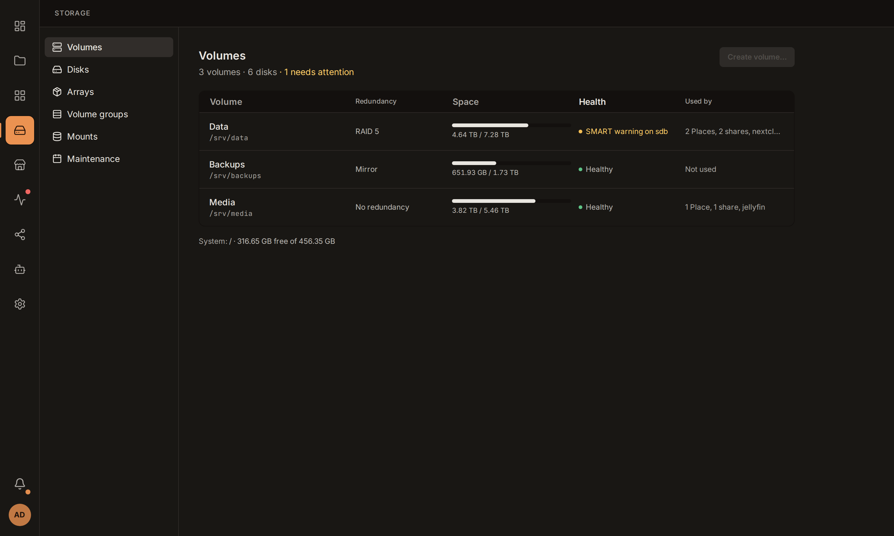

The Storage app manages the server's real disks: S.M.A.R.T. health, `mdadm` RAID,
LVM and mounts. It is organized in tabs:

- **Disks**: every disk of the server, drawn as the bays of a chassis and colored
  by what uses it. See [Disks](/home-server-interface/guide/features/storage-disks/).
- **LVM**: the volumes, RAID arrays, volume groups and mounts. See
  [LVM volumes](/home-server-interface/guide/features/storage-lvm/).
- **Maintenance**: scheduled SMART self-tests and RAID checks, with a calendar of
  the next two weeks. See [Maintenance](/home-server-interface/guide/features/maintenance/).

Storage opens on Disks until a volume exists, then on LVM. Each tab keeps its
place: switching tabs and coming back shows the same page. Technical terms have a
help icon that leads to the [glossary](/home-server-interface/guide/features/storage-glossary/).

## Descriptions and drift

Each volume is described in `/etc/hsi/storage/`, readable without HSI: its disks by
serial number, its array, LVM, filesystem and mount. When the server no longer
matches it (a disk swapped by hand, an fstab line removed, an array stopped), the
volume's page says what differs, with **Reapply** to put the server back in line
and **Accept current state** to keep the change. See
[Storage descriptions](/home-server-interface/guide/storage-descriptions/).

## Every change is a plan

Formatting, partitions, arrays, LVM and mounts are shown as a plan before
anything runs: every command, every file change as a diff, and the disks that
will be erased with their model and serial number. See
[Plans and missing volumes](/home-server-interface/reference/storage-plans/).

## Without HSI

Arrays, volume groups and mounts are standard `mdadm`, LVM and `/etc/fstab`
configuration: see [RAID](/home-server-interface/guide/manage-without-hsi/#raid-mdadm) and
[Mounts](/home-server-interface/guide/manage-without-hsi/#mounts).
