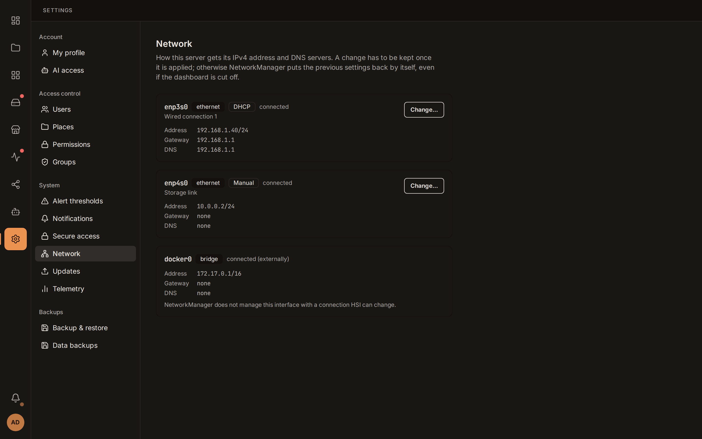
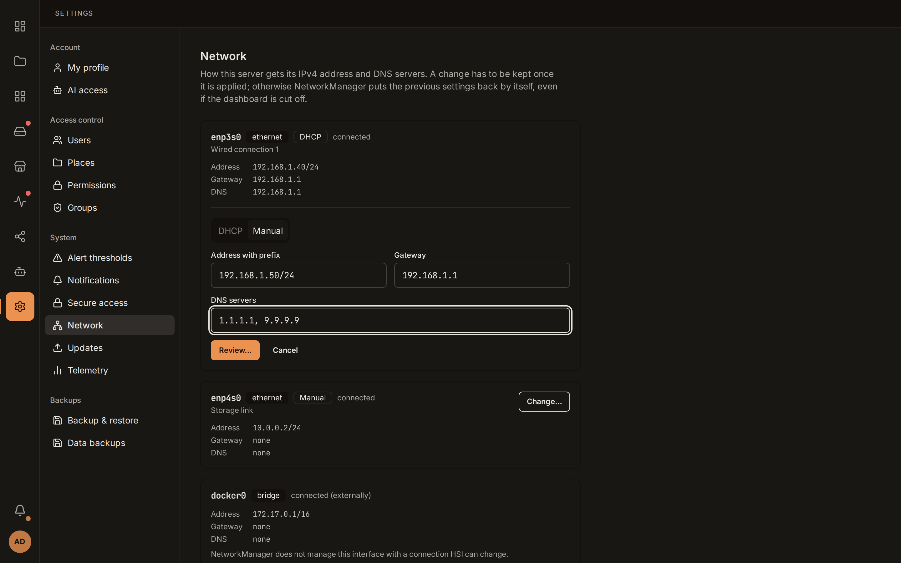
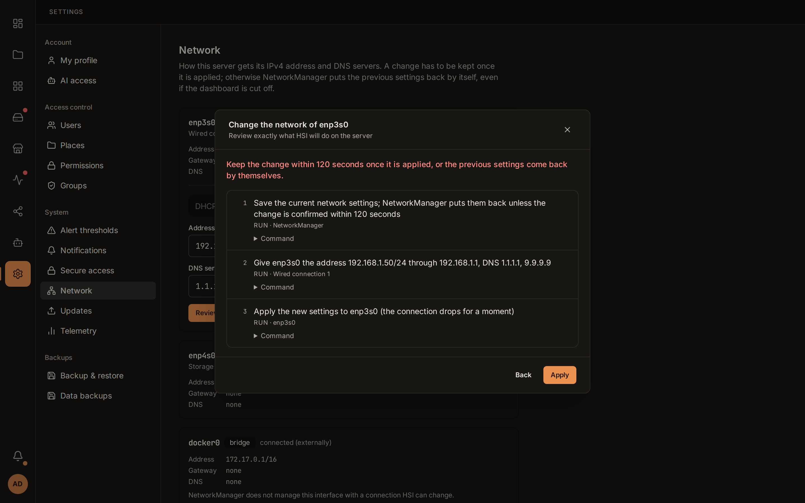
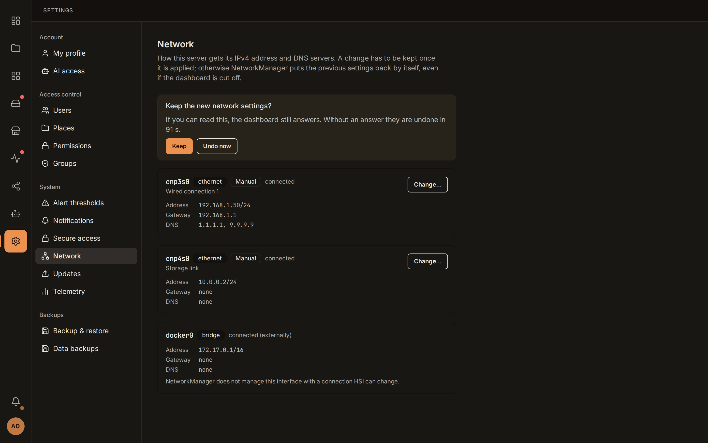

Settings > **Network** (administrators only) lists the server's interfaces and lets you
switch a wired or wireless interface between DHCP and a fixed address, and set its DNS
servers. HSI handles IPv4 only.



## Reading the page

Each interface has its own card:

- its **name** (`enp3s0`, `wlan0`...), its **type** (ethernet, wifi, bridge...) and its
  **state** as NetworkManager reports it;
- how it gets its address: **DHCP** (from the router) or **Manual** (fixed), and the name
  of the NetworkManager connection behind it;
- its current **address** with its prefix, its **gateway** and its **DNS** servers.

Only interfaces that NetworkManager manages through a connection have a **Change...**
button. The others, such as the bridges Docker creates for its containers, are shown for
reference with a note saying HSI cannot change them.

HSI changes the network through **NetworkManager**. When NetworkManager is not running,
or does not list any interface, the page shows what it can read and says why it cannot
change anything. Inside a container (LXC, for example) the network belongs to the
container host: set it there.

## Changing an interface



Click **Change...** on the interface, then choose:

- **DHCP**: the router gives the address, the gateway and, unless you set them here, the
  DNS servers. Leave **DNS servers** empty to keep the router's.
- **Manual**: enter the **address with its prefix** (`192.168.1.50/24`), the **gateway**
  (usually your router, `192.168.1.1`; optional for a link without internet access, such
  as a direct cable to another machine) and the **DNS servers**.

DNS servers are separated by commas or spaces (`1.1.1.1, 9.9.9.9`). Pick a fixed address
outside the range your router hands out by DHCP, so no other device receives it.

When the interface you change is the one the dashboard is open on, and its address
changes, the form says where the dashboard moves to before you go further.

## Reviewing and applying

**Review...** shows exactly what HSI will run on the server, like every other operation
that changes the system. Open **Command** under a step to see the command itself.



The change is applied under a NetworkManager *checkpoint*:

1. NetworkManager saves the current settings.
2. HSI applies the new ones; the connection drops for a moment.
3. The change has to be **kept within two minutes**. If nobody keeps it, NetworkManager
   puts the previous settings back by itself. This does not depend on HSI: it works even
   if the new settings cut the dashboard off, or if HSI's server stopped.

## Keeping the change

Once applied, the page asks whether to keep the new settings, with the time left:



- **Keep** makes the change permanent.
- **Undo now** puts the previous settings back at once, without waiting.

If you can read the question, the dashboard still answers on the new settings: keep them.
When the change moved the dashboard to another address, the review says which one. Open
it (`https://<new address>:9001`) and go to Settings > Network: the change still waiting
is listed there with **Keep** and **Undo now**. If the new address does not answer, wait
two minutes: the previous address comes back by itself.

Every change, kept or undone, is recorded in Monitor > Audit log.

## Recovering from the console

On the server itself (keyboard and screen, or a serial console):

```sh
# The interfaces and what NetworkManager does with them
nmcli device status
nmcli connection show

# A change still waiting: undo it now (or wait two minutes)
busctl get-property org.freedesktop.NetworkManager /org/freedesktop/NetworkManager \
  org.freedesktop.NetworkManager Checkpoints
busctl call org.freedesktop.NetworkManager /org/freedesktop/NetworkManager \
  org.freedesktop.NetworkManager CheckpointRollback o /org/freedesktop/NetworkManager/Checkpoint/<n>

# Back to DHCP on a connection
nmcli connection modify "<connection>" ipv4.method auto ipv4.addresses "" ipv4.gateway "" ipv4.dns ""
nmcli connection up "<connection>"
```

Changes made with `nmcli` are seen by HSI as they are: Settings > Network always reads
the server's current state.
